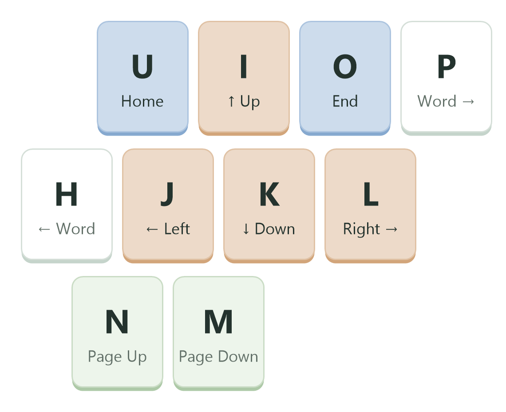

# Typing User Guide

Typing lets you navigate and edit in the foreground application using configurable keyboard commands. Turn on command mode to use single-key commands, or hold a configured modifier to use a shortcut. The active profile determines which keys do what.

## Get started

1. Extract the portable ZIP into a folder. Keep `Typing.exe`, `inputsim.dll`, `configuration.ini`, and the `profiles` and `languages` folders together.
2. Quit any older Typing or Aldetl instance using the same global toggle shortcut.
3. Run `Typing.exe`. Typing starts enabled in the Windows notification area (the tray); its main window stays hidden.
4. Open a text editor and place the cursor in some text.
5. With the default profile, tap and release **Caps Lock** or **Left Alt** alone to enter command mode. Press **I**, **J**, **K**, or **L** to move up, left, down, or right.
6. Tap a mode key again, or press **G**, to leave command mode and resume ordinary typing. Automatic mode exit after inactivity is also enabled by default.

The examples below use the bundled Default profile. Use **Mapping Profile** to inspect or edit your profile. The main tabs are **Mapping Profile**, **Event diagnostics**, **Settings**, and **Help**, in that order.

## Enable, disable, and exit

Enabling Typing allows it to recognize your configured commands. Command mode is a separate state: Typing can be enabled while command mode is off.

Use these controls to manage Typing:

| Control | Action |
| --- | --- |
| **Ctrl+U** by default | Toggle Typing enabled or disabled. |
| Double-click the tray icon | Toggle Typing enabled or disabled. |
| Tray **Enable** or **Disable** | One toggle item starts or stops keyboard handling; its label shows the next action. |
| Tray **Show Window** | Open the main window. |
| Close or minimize the main window | Hide the window and keep Typing running in the tray. |
| Tray **Exit** | Quit Typing. |

The tray menu lists **Show Window**, the **Enable/Disable** toggle, and **Exit**, in that order. Disable finishes output cleanup before stopping recognition. After a cleanup failure, use the tray toggle to retry the lifecycle change.

Open **Help** for a short introduction and examples of Vim and Emacs style caret movement and shortcut mapping. Select **Open User Guide…** below the examples to read this full guide in a separate resizable dialog with formatted headings, lists, tables, and inline text. The guide is read-only and scrollable; you can select and copy its text. Use **Close**, **Escape**, or the title-bar close button to return to Help. To check the application version, select **About** beside Open User Guide….

## Use command mode and shortcuts

A **mode key** toggles command mode when you press and release it alone. Holding it while pressing another key can run a configured shortcut instead. For example, the default **Caps Lock+J** moves left without first entering command mode.

The default profile uses Caps Lock as a mode key instead of its original capitalization toggle. To send the original **Caps Lock** key, hold **Caps Lock**, then press **Space** to turn capitalization on or off; this works with command mode either on or off.

Mappings with **Command mode** type run in command mode. Mappings with **Hotkey** type also work with command mode off, while Typing is enabled. Unmatched input passes through to the foreground application.

The cursor highlight shows command-mode or Caps Lock feedback when configured. When both apply, it shows two colored half-circles. The tray icon also distinguishes disabled, enabled, and command-mode states.

### Move and edit with the default profile

These keys run in command mode:

| Key | Action |
| --- | --- |
| **I / J / K / L** | Move up / left / down / right. |
| **H / P** | Move one word left / right. |
| **U / O** | Move to Home / End. |
| **N / M** | Page Up / Page Down. |
| **Left Shift** plus a movement key | Select text while moving. |
| **E / R** | Delete / Backspace. |
| **F / D / S / A** | Set a movement step of 1 / 2 / 5 / 10. |
| **V** | Toggle selection for subsequent movement. |
| **Q** | Request the opposite of the most recent recorded movement. |
| **Y / T** | Insert the local date / time. |
| **G** | Leave command mode. |

*Default command-mode movement keys.* Home and End follow the application's cursor behavior.

A step applies to the next movement attempt. For reversible direction pairs, that count remains in use for the pair until changed or command mode resets. For example, **S**, then **J**, moves left five times; **L** then moves right five times. Use **F** before a movement to restore its count to one. Home and End do not retain a count.

**Q** reverses a recorded movement; it does not undo document edits. Use your application's usual undo shortcut, such as **Ctrl+Z**, to undo edits.

Selection adds Shift to movement output. Tap **V** again to turn it off. Leaving command mode clears selection and movement counts; entering command mode also clears movement history.

The mapping editor's **Caps Lock** action supplies the capitalization toggle (`CapsLock` or `capslock` in a profile file). Right Shift combinations do not toggle capitalization in the default profile. While Caps Lock is a mode key, overlapping another key suppresses its normal capitalization function; only an isolated tap switches command mode.

## Customize mappings

Open the main window and select **Mapping Profile**. A profile is an independent `.typing.ini` file containing mode keys, command-mode mappings, and hotkeys.

### Edit and activate a profile

1. Choose a saved profile from the **Profile** dropdown to open it for editing without changing the active profile. The dropdown shows names from the app's **profiles** directory only; subdirectories and other locations are excluded.
2. Use **New** for an empty named draft or **Copy** for a named copy of the editor's current mappings. Copy includes unsaved mapping edits and leaves the source file unchanged.
3. Use **Key mapping: Add, Edit, Delete** above the table. Each mapping has an **Enabled** state, **Type**, **Trigger**, **Action**, and **Diagnostics**. Enter a trigger or select Record trigger. Press and release a valid shortcut to place it directly in the Trigger field; an invalid or stopped recording leaves the previous value unchanged. The same recording flow applies to Record output. Use Stop recording to end capture without changing the field. Choose Mode key, Command mode, or Hotkey from Type, then choose an action and its parameters. Confirm updates the draft; Cancel leaves the mapping unchanged.
4. Use **Save** to write changes. New, copied, and imported profiles save in the default profiles directory. Saving never changes the running mappings. Select **Set as active** beside the dropdown to save any pending edits and activate the displayed profile after output cleanup.

Click a **Type**, **Trigger**, or **Action** heading to sort the mappings by its text. Click the same heading again to reverse the order; the arrow shows the direction. Sorting keeps selected mappings selected and leaves diagnostic-only rows at the bottom. It changes only the display order, without changing the profile or its saved order.

Use the **Enabled** checkbox in the table or Add/Edit dialog to keep a mapping in the profile while turning it off. New mappings start enabled. Disabled mappings retain their trigger and action but do not handle keys; disabling a Mode key also stops it entering command mode. Save persists the state, and **Set as active** applies it. Copy and Import preserve disabled mappings. Profiles using disabled mappings are saved as format version 2, which older clients cannot open.

The page shows active and edited names without paths, and distinguishes unsaved changes, saved inactive files, and active saved revisions. If activation of a saved active-profile revision fails, use **Set as active** to retry. Shortcut recording preserves left/right modifiers and captures the global toggle without executing it.

### Manage profiles

Use these actions to manage profile files and edits:

| Action | Effect |
| --- | --- |
| **Save** | Write the edited profile without changing the running mappings. |
| **Set as active** | Save and activate the displayed profile; retry a failed activation. |
| **Save As** | Choose any writable destination. Files saved outside the default profiles directory stay out of the dropdown. Import a copy to make one available there. |
| **Rename** | Request a unique display name, then Save the change. The existing filename is retained. |
| **New** | Create an empty named draft. Save it to add it to the dropdown. |
| **Copy** | Create a named draft from the current mappings, including unsaved edits. Save it as an independent profile. |
| **Delete** | Choose an inactive available profile and confirm deletion. The active profile is excluded; activate another profile with Set as active before deleting it. |
| **Import** | Choose a profile or legacy INI, then name the imported draft. Save it to the default profiles directory. The source file is retained. |
| Minimize the main window | Keep the working copy in memory. |
| Close the main window, replace an edited profile, delete the edited profile, or exit | Choose Save, Don't Save, or Cancel when prompted. Cancel keeps editing; Don't Save abandons the edits. |

Saving checks for external file changes and keeps the previous destination in a sibling **.bak** file. Available profile names must be unique for New, Copy, Import, or Rename. An empty profile intentionally has no mappings or mode keys.

### Key names and profile notation

Use **Record trigger** or **Record output** to capture a shortcut with the correct key names. When typing a shortcut, put modifiers before the final key and separate them with `+`, for example `LMenu+C` or `Control+Shift+Left`. Left and right modifier keys have distinct names:

| Modifier | Left key | Right key |
| --- | --- | --- |
| Control | `LControlKey` | `RControlKey` |
| Shift | `LShiftKey` | `RShiftKey` |
| Alt | `LMenu` | `RMenu` |

Caps Lock is named `CapsLock`. Use the explicit left/right names when the side matters. The Default profile declares Caps Lock and Left Alt as mode keys; each can be tapped alone for command mode or used in configured shortcuts.

If editing a profile file directly, use `Trigger=Action`. For example, `LMenu+C=Control+C` maps Left Alt+C to Ctrl+C. `[modekeys]` contains mode-key declarations such as `CapsLock=mode` and command-mode mappings such as `J=Left`; `[hotkeys]` contains shortcuts that also work with command mode off. The `[profile]` section contains the profile name and format version.

In version 2, `!J=Left` keeps the mapping disabled; `J=Left` enables it. A line beginning with `;` is a comment and does not appear as an editable mapping. Use the Enabled state to retain mappings you want to switch on again. For a movement step, choose **Step count** with a positive integer in the editor; the file notation is `stepN`, for example `F=step1`.

## Change application preferences

In **Settings**, choose **System default**, **English**, or **简体中文** from **Language**. The interface changes immediately, preserving mapping edits and the running mappings. Typing remembers the selection per user in `%LOCALAPPDATA%\Typing\language.txt`. A failed language change preserves the previous selection and displays an error; startup uses English if a saved language profile cannot be loaded.

Language profiles are UTF-8 `.ini` files in the app's `languages` folder, separate from mapping profiles. Their stable message IDs can be translated without rebuilding Typing. Missing translations use English. The matching `.md` file supplies the full guide; a missing guide uses the English guide. Files are loaded at startup and when choosing a different language. After editing the current language file, switch away and back or restart to reload it. System-language changes take effect on the next launch or after switching away from and back to System default. Language selection does not change keyboard layout, the input method, profile notation, or date/time command output. System-managed dialog buttons and Windows error descriptions may remain in the Windows language.

Open **Settings** and check **Start with Windows** to start Typing in the system tray when you sign in. Uncheck it to cancel automatic startup. Changes take effect immediately without Save or Apply, and affect only your Windows user account. The option is off until you enable it. Changing it does not stop the running app or change your mappings.

If you move the portable Typing folder, enable the option again from its new location. If a change fails, Settings displays the error and keeps the preceding checkbox state. If the setting cannot be read, reopen Settings to retry. Windows Startup Apps controls or organization policy can separately prevent automatic launch.

Other application preferences live in `configuration.ini` beside the executable. They include the global enable/disable shortcut, automatic command-mode exit, and cursor feedback. Edit this file and restart Typing to change them.

The bundled settings use `hotkey=Control+U`, `mode_auto_exit=on`, and `mode_auto_exit_time=2`. Cursor feedback accepts `mode_cursor_tip=on` or `off`; the older `mode_mouse_tip` name is also supported. If both names appear, `mode_cursor_tip` takes precedence, and both supplied values must be valid.

Successful profile activation remembers the profile under `[profiles] active`. Relative profile paths resolve from the directory containing `configuration.ini`.

Typing stores the remembered window size and diagnostic log under `%LOCALAPPDATA%\Typing`, with user-profile and temporary-directory fallbacks. Diagnostic logging runs automatically in the background for troubleshooting. It preserves history across launches, keeping `typing.log` and up to three archives (`typing.log.1` through `.3`), each limited to 1 MiB. The `.lock` file coordinates access and may remain beside them.

Logging failures are silently ignored. A busy logger may drop messages, and the last messages may be lost when Typing exits; logging never waits for disk writes before letting the app continue or quit. Normal logs contain lifecycle context and failures, not a record of your typing or every successful command.

## Troubleshoot

Check these conditions if Typing does not behave as expected:

| Symptom | What to check |
| --- | --- |
| No main window appears at startup | Look in the Windows notification area and choose **Show Window**. |
| Command keys type letters | Check that Typing is enabled, enter command mode, and check the active profile. Automatic mode exit may have returned you to ordinary typing. |
| Saved mappings do not take effect | Choose the profile for editing, then use **Set as active** to apply it. Saving alone does not change running mappings. Use Set as active again to retry a failed activation. |
| Startup reports an invalid application configuration | Correct the file at the reported path, then restart. Typing exits before starting keyboard handling and leaves the file unchanged. |
| Startup opens profile recovery | Select a valid profile in Mapping Profile, or create and save one, then use Set as active. Commands remain unavailable until recovery succeeds. |
| The global toggle cannot be registered | Quit another Typing or Aldetl instance using that shortcut, or configure a different shortcut and restart. |
| Closing the window does not stop Typing | Use **Disable** to stop command recognition or tray **Exit** to quit. |

The **Event diagnostics** tab shows keyboard input events. Use **Show keyboard events** to control the display. The keyboard event table fills the available space.
Use **Clear** beside the checkbox to empty the displayed history without changing keyboard capture or the checkbox.
